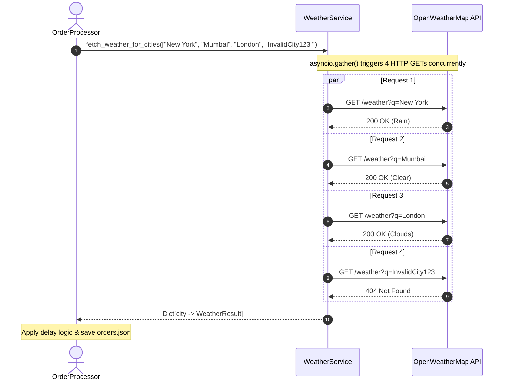

# Weather-Aware Order Delivery System

A high-performance, asynchronous Python system that checks live weather conditions for customer destination cities using the **OpenWeatherMap API** and automatically flags delivery orders as **`Delayed`** when adverse weather conditions (`Rain`, `Snow`, `Extreme`) are detected.

---

## Table of Contents
1. [Project Overview](#project-overview)
2. [Key Features](#key-features)
3. [Technologies Used](#technologies-used)
4. [Project Structure](#project-structure)
5. [OpenWeatherMap API Key Setup](#openweathermap-api-key-setup)
6. [Installation & Setup](#installation--setup)
7. [Running the Application](#running-the-application)
8. [How Parallel Fetching Works](#how-parallel-fetching-works)
9. [Weather-Based Delay Logic](#weather-based-delay-logic)
10. [Error Handling & Fault Resilience](#error-handling--fault-resilience)
11. [Sample Terminal Output](#sample-terminal-output)
12. [Running Tests](#running-tests)
13. [Submission Checklist](#submission-checklist)

---

## Project Overview

Logistics and delivery networks frequently suffer unexpected disruptions from adverse weather conditions such as heavy downpours, blizzards, and severe storms. 

The **Weather-Aware Order Delivery System**:
- Ingests delivery orders from a local JSON database (`orders.json`).
- Asynchronously queries the OpenWeatherMap API for all destination cities concurrently.
- Evaluates weather categories against business delay rules.
- Automatically transitions affected orders to `Delayed` while generating personalized, empathetic apology messages for customers.
- Logs errors (such as invalid city names) without crashing or disrupting valid orders.
- Writes enriched order records back to `orders.json` and prints an executive summary to the terminal.

---

## Key Features

- **Concurrent Async Architecture**: Utilizes `aiohttp` and `asyncio.gather()` to fetch weather across all cities simultaneously, reducing runtime from $O(N)$ sequential delays to $O(1)$ parallel latency.
- **Automated Delay Classification**: Flags orders with `Rain`, `Snow`, or `Extreme` conditions as `Delayed`.
- **Weather-Aware Apology Generator**: Reusable, AI-assisted generator creating personalized customer apologies based on the customer's name, city, and specific weather severity (with zero paid API dependencies at runtime).
- **Graceful Fault Tolerance**: Handles invalid cities (e.g. `InvalidCity123`), network drops, timeouts, and API rate limits cleanly. One broken city never halts the pipeline.
- **Secure Configuration**: Strictly protects API credentials via `.env` and `python-dotenv`.
- **Local JSON Persistence**: Safely updates `orders.json` with weather details and apology messages while preserving all original order fields.
- **Comprehensive Test Suite**: 34 unit and integration tests using `pytest` and `pytest-asyncio` with mocked API responses (runs 100% offline).

---

## Technologies Used

| Technology | Purpose |
| :--- | :--- |
| **Python 3.10+** | Core programming language |
| **aiohttp** | Asynchronous HTTP client for non-blocking API communication |
| **asyncio** | Python standard library for coroutines and event loop management |
| **OpenWeatherMap API** | Live global weather data (Free Tier 2.5 Current Weather API) |
| **python-dotenv** | Secure environment variable configuration |
| **colorama** | Cross-platform ANSI terminal coloring |
| **pytest & pytest-asyncio** | Automated test suite and async mocking |

---

## Project Structure

```text
Weather-Aware-Order-Delivery-System/
│
├── main.py                    # Application entry point, CLI UI & logging setup
├── weather_service.py         # Async OpenWeatherMap client using asyncio.gather()
├── order_processor.py         # Business logic: delay detection, order updates, JSON I/O
├── apology_generator.py       # Weather-aware personalized apology message generator
├── orders.json                # Local order database (input and updated output)
├── requirements.txt           # Project dependencies
├── .env                       # Environment variables (API Key - git ignored)
├── .env.example               # Example environment template with instructions
├── .gitignore                 # Git ignore rules for keys, caches, and logs
├── README.md                  # Comprehensive project documentation
├── AI_LOG.md                  # Documentation of prompts used during development
├── logs/
│   ├── .gitkeep              # Preserves logs directory in version control
│   └── weather_errors.log    # Structured log of API warnings and invalid city errors
└── tests/
    ├── __init__.py            # Test package marker
    ├── test_apology.py        # Unit tests for apology generator & name extraction
    └── test_order_processor.py# Unit & integration tests for async service & delay rules
```

---

## OpenWeatherMap API Key Setup

1. **Sign Up**: Create a free account at [OpenWeatherMap Sign-up](https://home.openweathermap.org/users/sign_up).
2. **Generate API Key**: Visit [API Keys](https://home.openweathermap.org/api_keys) and copy your default key (or generate a new one).
3. **Configure `.env`**:
   Open the `.env` file in the project root directory and paste your key:
   ```env
   OPENWEATHERMAP_API_KEY=your_actual_api_key_here
   ```
   *(Note: Newly created OpenWeatherMap keys may take 10–30 minutes to activate globally on OpenWeatherMap's servers).*

---

## Installation & Setup

### 1. Clone or Extract the Project
Navigate to the project root directory in your terminal or PowerShell:
```bash
cd "d:/Weather-Aware Order Delivery System"
```

### 2. (Optional) Create and Activate a Virtual Environment
```bash
# Windows (PowerShell)
python -m venv venv
.\venv\Scripts\Activate.ps1

# macOS / Linux
python3 -m venv venv
source venv/bin/activate
```

### 3. Install Dependencies
```bash
pip install -r requirements.txt
```

---

## Running the Application

Execute the application using standard Python:

```bash
python main.py
```

If the API key is not yet set in `.env`, the program will halt gracefully and display interactive configuration guidance:

```text
========================================================================
  [!] CONFIGURATION REQUIRED: OPENWEATHERMAP API KEY MISSING
========================================================================

To run the Weather-Aware Order Delivery System:
  1. Create a free account at: https://home.openweathermap.org/users/sign_up
  2. Generate a free API key at: https://home.openweathermap.org/api_keys
  3. Open the '.env' file in this project directory.
  4. Set your key:
       OPENWEATHERMAP_API_KEY=your_actual_api_key_here
  5. Run the program again:
       python main.py
========================================================================
```

Once a valid key is provided in `.env`, the program runs end-to-end, fetching all cities in parallel and updating `orders.json`.

---

## How Parallel Fetching Works

Sequential API requests create latency bottlenecks. If fetching weather for one city takes 800ms, checking 4 cities sequentially takes $\approx 3.2\text{s}$.

Our system uses Python's asynchronous event loop with `aiohttp.ClientSession` and `asyncio.gather()` in `weather_service.py`:

```python
async with aiohttp.ClientSession(timeout=self.timeout) as session:
    # Trigger all city requests concurrently
    tasks = [self.fetch_weather_for_city(session, city) for city in unique_cities]
    results: List[WeatherResult] = await asyncio.gather(*tasks)
```



---

## Weather-Based Delay Logic

The delay decision is handled by `OrderProcessor.is_delay_condition()`:

$$\text{Status} = \begin{cases} \text{"Delayed"}, & \text{if } \text{main} \in \{\text{"Rain"}, \text{"Snow"}, \text{"Extreme"}\} \\ \text{"Pending"}, & \text{otherwise} \end{cases}$$

- **Rain, Snow, Extreme**:
  - `status` is updated to `"Delayed"`.
  - A weather-aware personalized apology is generated using `generate_apology()`.
- **Other conditions (Clear, Clouds, Mist, etc.)**:
  - `status` remains `"Pending"`.
  - Order stays on track; no apology needed.
- **Preservation of Fields**:
  - Original fields (`order_id`, `customer`, `city`, `status`) are preserved.
  - Enriched fields (`weather_condition`, `weather_description`, `temperature_c`, `last_checked_at`, `apology_message`) are added.

---

## Error Handling & Fault Resilience

1. **Invalid City Names (`InvalidCity123`)**:
   - OpenWeatherMap returns HTTP 404: `{"cod": "404", "message": "city not found"}`.
   - Handled inside `fetch_weather_for_city()` and logged to `logs/weather_errors.log`.
   - The order's status remains `"Pending"` with an informative `weather_error` attribute.
   - Counted under `Failed Weather Requests` and not counted under `Successfully Processed`.
2. **Network Failures and Timeouts**:
   - `asyncio.TimeoutError` and `aiohttp.ClientError` are caught per task.
   - One failed city does not interrupt other running requests.
3. **Structured Logging**:
   - Warnings and errors are appended to `logs/weather_errors.log` with timestamps.

---

## Sample Terminal Output

When executing `python main.py` with an active OpenWeatherMap API key:

```text
Starting Weather-Aware Order Delivery System...
Fetching weather conditions for order destination cities in parallel...

============================================================================
  WEATHER-AWARE ORDER DELIVERY SYSTEM - PROCESSING SUMMARY
============================================================================
  * Total Orders:                4
  * Successfully Processed:      3
  * Delayed Orders:              1
  * Pending Orders:              2
  * Failed Weather Requests:     1
----------------------------------------------------------------------------
  ID     Customer           City             Weather        Status    
  ------------------------------------------------------------------------
  1001   Alice Smith        New York         Rain           Delayed   
    └─ Apology: "Hi Alice, your order to New York is delayed due to light rain. We appreciate your patience while our delivery team navigates the roads safely!"
  1002   Bob Jones          Mumbai           Clear          Pending   
  1003   Charlie Green      London           Clouds         Pending   
  1004   InvalidCity123     InvalidCity123   Failed         Pending*  
    └─ Error: City 'InvalidCity123' not found (HTTP 404 - Invalid City).
============================================================================
  [i] 1 weather lookup issue(s) logged to logs/weather_errors.log
  [✓] Updated orders saved successfully to 'orders.json'
============================================================================
```

And `orders.json` is automatically updated:

```json
[
  {
    "order_id": "1001",
    "customer": "Alice Smith",
    "city": "New York",
    "status": "Delayed",
    "weather_condition": "Rain",
    "weather_description": "light rain",
    "temperature_c": 11.4,
    "last_checked_at": "2026-11-01T12:35:00.000000+00:00",
    "apology_message": "Hi Alice, your order to New York is delayed due to light rain. We appreciate your patience while our delivery team navigates the roads safely!"
  },
  {
    "order_id": "1002",
    "customer": "Bob Jones",
    "city": "Mumbai",
    "status": "Pending",
    "weather_condition": "Clear",
    "weather_description": "clear sky",
    "temperature_c": 29.8,
    "last_checked_at": "2026-11-01T12:35:00.000000+00:00"
  },
  {
    "order_id": "1003",
    "customer": "Charlie Green",
    "city": "London",
    "status": "Pending",
    "weather_condition": "Clouds",
    "weather_description": "overcast clouds",
    "temperature_c": 9.2,
    "last_checked_at": "2026-11-01T12:35:00.000000+00:00"
  },
  {
    "order_id": "1004",
    "customer": "InvalidCity123",
    "city": "InvalidCity123",
    "status": "Pending",
    "weather_condition": null,
    "weather_description": null,
    "weather_error": "City 'InvalidCity123' not found (HTTP 404 - Invalid City).",
    "last_checked_at": "2026-11-01T12:35:00.000000+00:00"
  }
]
```

---

## Running Tests

The test suite contains 34 comprehensive tests covering delay logic, apology generation, name extraction, mocked async HTTP requests, 404 handling, and end-to-end execution.

To run all tests:
```bash
pytest -v
```

Output:
```text
============================= test session starts =============================
platform win32 -- Python 3.10.0, pytest-9.0.3, pluggy-1.6.0
collected 34 items

tests/test_apology.py::TestApologyGenerator::test_extract_first_name_full_name PASSED
tests/test_apology.py::TestApologyGenerator::test_rain_apology_default_description PASSED
tests/test_apology.py::TestApologyGenerator::test_snow_apology_default PASSED
tests/test_apology.py::TestApologyGenerator::test_extreme_apology_default PASSED
tests/test_order_processor.py::TestDelayLogic::test_delay_conditions_trigger_delay[Rain] PASSED
tests/test_order_processor.py::TestWeatherService::test_fetch_weather_success_200 PASSED
tests/test_order_processor.py::TestWeatherService::test_fetch_weather_invalid_city_404 PASSED
tests/test_order_processor.py::TestWeatherService::test_parallel_fetching_uses_gather PASSED
tests/test_order_processor.py::TestOrderProcessor::test_process_orders_golden_flow PASSED
tests/test_order_processor.py::TestOrderProcessor::test_failure_of_one_city_does_not_abort_others PASSED
...
============================= 34 passed in 0.91s ==============================
```

---

## Submission Checklist

Before submitting your assignment, follow these final steps:

1. **Add Your API Key**:
   Put your active OpenWeatherMap API key into `.env`.
2. **Execute the Application**:
   Run `python main.py` to trigger live weather checks and update `orders.json`.
3. **Verify `orders.json`**:
   Open `orders.json` and ensure orders are updated with current live weather.
4. **Inspect `logs/weather_errors.log`**:
   Check that `InvalidCity123` is recorded with an HTTP 404 error log.
5. **Run the Test Suite**:
   Run `pytest -v` to ensure all 34 tests pass.
6. **Record Demo Video**:
   Record a short 2–3 minute video or screen capture demonstrating:
   - Setting up `.env` (or showing the missing key prompt).
   - Running `python main.py` in the terminal.
   - Showing the terminal summary table.
   - Showing the updated `orders.json` file.
   - Showing `logs/weather_errors.log`.
   - Running `pytest -v`.
7. **Package Source Code**:
   Zip or push the repository to GitHub (ensure `.env` is omitted from version control).

